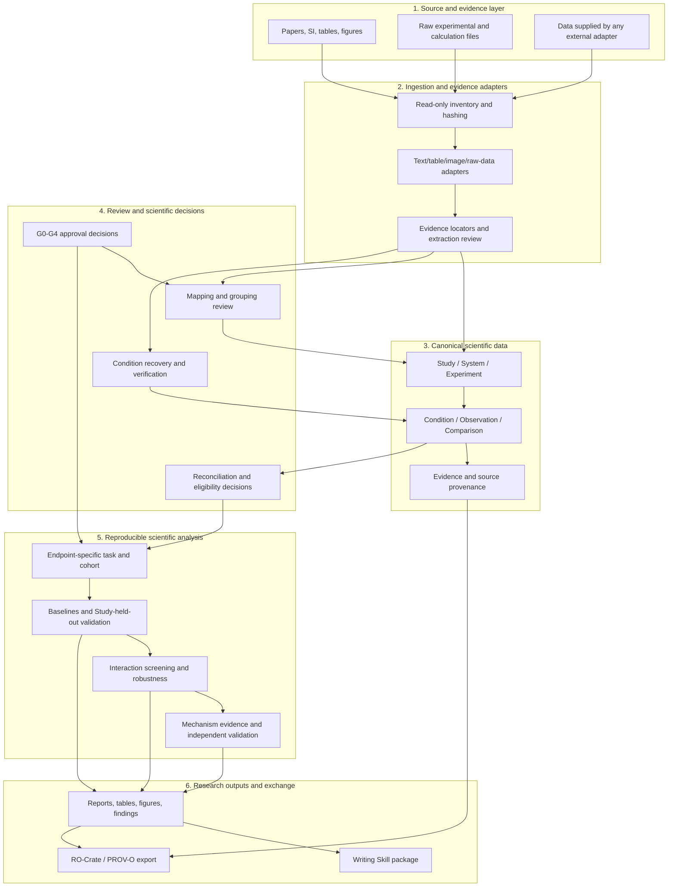

# DOR Target Architecture

**Architecture review date:** 2026-11-12  
**Baseline:** `v0.1-foundation` at `6275727279f680e887cb9672652a52bbc188eae0`  
**Status:** target architecture and responsibility boundaries; not a mandate for immediate code migration.

## 1. Architectural objective

DOR is a **guided scientific evidence and reproducibility framework**. It turns selected research sources into a reviewed, structured scientific representation, supports reproducible analyses over explicitly defined endpoints and Study groups, and packages the resulting evidence so that another person or tool can inspect and reuse it.

The central object is not a model, a gate, a ledger, or a JSON file. It is the **traceable scientific claim/evidence chain**:

```text
Research source
  -> source passage / table / figure / raw measurement
  -> reviewed scientific entity and value
  -> condition / experiment / observation relationship
  -> analysis input and decision
  -> computational activity and output
  -> finding, limitation, or hypothesis
  -> publication artifact and claim
```

For every consequential value or claim, DOR should make it possible to answer:

- What source or upstream artifact supports it?
- What exact locator and source version were used?
- Which Study, System, Experiment, Condition, and Observation does it describe?
- What was reported, what was normalized, and what remains unknown or disputed?
- Which transformation, configuration, software version, and computational run produced it?
- Which human decision accepted, rejected, or limited its use?
- Which analysis and publication claims depend on it?

DOR must preserve uncertainty and missing information rather than create an appearance of completeness.

## 1A. Discovery-first research entry

The Scientific Discovery Engine is the default entry point for a new research programme when an existing structured corpus is available. It runs before a formal G0-G4 project Run and does not replace scientific approvals.

Its initial deterministic scan:
- profiles the complete structured corpus locally;
- computes feature/unit support, DOI-verified Study coverage, structured condition coverage, descriptive per-Study summaries, and explicitly qualified co-occurrence opportunities;
- emits aggregate tables, a machine-readable report, source/output hashes, and a bounded Agent research brief;
- keeps raw records and paper bodies out of Agent context.

The Agent uses the brief and domain profile to propose testable research opportunities. Semantic mappings, endpoint comparability, experiment-level linkage, confounding, novelty, and physical interpretation remain explicit review requirements. Only after the user selects a research direction does the workflow enter formal scope definition and G0-G4 analysis.

The exploratory scan is not a scientific finding and does not authorize canonical mapping, value reconciliation, model fitting, or mechanism claims. Its purpose is to discover what is worth studying in the corpus before committing to a formal analysis plan.

## 2. Target architecture at a glance



The diagram describes the desired flow and responsibility boundaries. It does not imply that every adapter, exporter, or integration exists today.

## 3. Architectural layers and responsibilities

### Layer 1 — Immutable source and evidence layer

**Purpose:** preserve the research material as the authority for what was actually reported or measured.

Inputs may include:
- source documents and supplementary records;
- structured records and tabular datasets;
- binary media, images, and instrument-generated files;
- computational or simulation inputs and outputs;
- externally generated derived datasets with their own manifests.

Rules:
- Original sources are read-only.
- Every selected source has a stable source ID, exact path or resolvable identifier, media type, file size where available, and SHA-256.
- A derived or extracted artifact never silently replaces its source.
- A source snapshot defines what was available to the run; it does not force every available file into the analysis.
- Source restrictions and redistribution rights must be retained when preparing an external package.

**Current implementation:** source hashing and CSV/JSON audit are present. The current Runtime does not natively extract PDF tables, interpret figure panels, or parse scientific image/raw instrument formats. These remain adapter responsibilities.

### Layer 2 — Ingestion and evidence adapters

**Purpose:** convert heterogeneous source representations into reviewable evidence artifacts without deciding scientific meaning.

An adapter should have a stable contract:
- adapter name and version;
- accepted input types and required metadata;
- exact input source IDs and hashes;
- extracted records or candidate evidence;
- locator type and locator value;
- extraction confidence/uncertainty where meaningful;
- errors, omissions, unsupported content, and unresolved references;
- output artifact hashes.

The adapter boundary should support different implementations for different source types:
- structured-data inspection and normalization;
- document and record extraction;
- image and media extraction;
- time-series and instrument-file conversion;
- computational output conversion.

Adapters must not silently promote extracted values to reviewed scientific facts. Their outputs are candidates with exact provenance.

**Worker role:** Agents/Workers can interpret selected source records and project context, but must return bounded, source-grounded proposals. The host Supervisor shows role/provider/model/project/inputs/staging outputs before dispatch and waits for explicit authorization. Worker output remains in staging until reviewed and promoted.

### Layer 3 — Canonical scientific representation

**Purpose:** hold the reviewed scientific meaning and relationships needed for analysis.

The DOR core model remains:

- **Study** — the publication or independently identified research source.
- **System** — material, specimen, cell, device, or investigated system.
- **Experiment** — a specific experimental procedure or test.
- **Condition** — reported preparation, environment, operating state, or protocol variable.
- **Observation** — a measured/reported result with exact target, endpoint, unit, timepoint, and identity.
- **Comparison** — an explicitly supported relation among observations.
- **Evidence** — source passage, table cell, figure panel, SI item, raw file, or metadata locator.

Important rules:
- One source row is not automatically one Experiment or replicate.
- Repeated measurements remain separate unless their identity and aggregation rule are supported.
- A Study may describe multiple Systems and Experiments.
- A Condition can have multiple instances; it is not necessarily one scalar per material.
- An Observation may have several evidence records.
- Endpoint labels are not equivalent unless their definitions and contexts are compatible.
- Reported labels are not assumed to describe the complete realized physical state.
- Raw values/units/qualifiers and normalized values/units are separate.
- Missingness states remain explicit: REPORTED, NOT_REPORTED, NOT_APPLICABLE, AMBIGUOUS, CONFLICTING, and NOT_ASSESSED.

The canonical model is intentionally DOR-specific because its Observation/Condition/Evidence and unresolved-grain requirements are central to the methodology. External vocabularies should be mapped to it, not used to erase distinctions that matter scientifically.

### Layer 4 — Review and scientific decision layer

**Purpose:** distinguish computational validity from human scientific judgment.

Keep separate review activities for:
1. source selection and scope;
2. extraction fidelity and locator checks;
3. source-to-canonical semantic mapping;
4. entity grain and relationship review;
5. condition recovery and status decisions;
6. reconciliation of conflicting or ambiguous records;
7. analysis task, cohort, and exclusion decisions;
8. candidate finding and mechanism review;
9. final deliverable scope and limitations.

A review decision must record the exact artifact version it concerns, the reviewer declaration, time, rationale, and decision outcome. A hash proves file identity/integrity relative to the recorded digest; it does not authenticate the person or prove that the scientific judgment is correct.

Review decisions should not mutate original sources or silently rewrite canonical observations. Corrections create new reviewed versions with a traceable reason and invalidation path.

### Layer 5 — Reproducible scientific analysis

**Purpose:** transform accepted scientific representations into bounded analytical results.

The analysis boundary begins with an explicit task contract:
- exact target and endpoint definition;
- selected raw or normalized value field;
- expected unit;
- exact feature bindings;
- observation/condition matching rules;
- inclusion/exclusion and unresolved-evidence policy;
- Study grouping and split design;
- model families, metrics, seeds, and computational budgets.

Analysis steps should remain separable at meaningful input/output reuse boundaries:
- cohort construction;
- baseline model fitting;
- nested Study-held-out evaluation;
- interaction discovery;
- repeated-seed or other robustness checks;
- selected response-surface diagnostics;
- virtual scenario estimates;
- mechanism evidence bridge;
- optional atomistic/continuum/external scientific calculations.

Python remains authoritative for deterministic numeric operations. Agents support planning, semantic interpretation, critical review, and hypothesis construction; they do not replace numeric artifacts or invent missing data.

The analytical claim ladder remains explicit:

1. source-reported observation;
2. statistical association;
3. model-specific predictive interaction;
4. cross-Study predictive stability under the declared protocol;
5. mechanism hypothesis;
6. independently supported mechanism interpretation;
7. prospective validation.

A result may not be promoted automatically from one level to the next.

### Layer 6 — Research output and exchange

**Purpose:** produce a complete, independently inspectable research object.

The DOR publication package remains the writing-oriented hand-off. It should provide:
- Writing Skill guide;
- machine-readable artifact manifest;
- figures and tables with source data and generation provenance;
- analysis configuration and validation reports;
- structured findings and evidence/claim links;
- contradictions, limitations, unresolved items, and missing outputs;
- exact source/derived artifact identifiers and hashes.

The external interoperability layer should additionally export:
- RO-Crate metadata for the research object;
- PROV-O-compatible provenance links;
- Workflow Run RO-Crate records for the runs that match the selected profile;
- Frictionless descriptors for tabular resources where appropriate;
- project-owned vocabulary and unit mappings where semantically justified.

The exporter should describe the exact selected package contents; it must not crawl a workspace and guess which files belong to a study.

## 4. Authoritative state and ledger responsibilities

DOR currently has three append-only or hash-bound histories. Retain their distinct purposes, but make their authority explicit.

| Record/history | Authoritative question | It owns | It does not own |
|---|---|---|---|
| Run Event Ledger | What computation/stage attempt actually happened? | Stage attempts, exact input/output hashes, execution metadata, Worker authorization record, run initialization and resume state | Scientific approval, semantic correctness, final acceptance |
| G0–G4 Workflow Gate Ledger | Which scientific decision was made for this exact packet? | Scope, mapping/canonical/analysis approval, candidate selection, finalization approval, upstream decision dependencies | Computation execution history, full eight-stage acceptance summary, reviewer authentication |
| V1.0 Acceptance Revision Ledger | What is the controlled acceptance state of this selected real-data pilot, and how did it change? | Eight-stage acceptance statuses, evidence references, invalidation history, final assessment, cross-ledger consistency | Replacing Run events or changing a Gate decision |

### Relationship between G0–G4 and the eight V1.0 Acceptance stages

The two sequences serve different purposes: G0–G4 are decision gates; the eight-stage Acceptance Record is a controlled acceptance checklist and history. They should be mapped, not treated as competing linear workflows.

| V1.0 Acceptance stage | Primary relationship | Interpretation |
|---|---|---|
| source_selection | G0 | Scope and selected/excluded source snapshot |
| source_integrity | Run initialization and Run Event Ledger | Source snapshot and protected workspace integrity |
| extraction_review | Supports G1 | Evidence extraction/locator review before semantic mapping approval |
| semantic_mapping | G1 | Source-to-canonical mapping and entity-grain approval |
| canonical_reconciliation | G2 | Canonical bundle, reconciliation state, endpoint task and analysis readiness |
| cohort_feasibility | G2-approved analysis plan | Endpoint-specific Study/Observation support and split feasibility |
| modeling_validation | G2-approved analysis plan; informs G3 | Study-level model/evaluation result; not itself an interaction-selection approval |
| publication_handoff | G4 | Exact package and reviewed result scope |

A Gate event must not be inferred from an Acceptance stage PASS. An Acceptance stage must not be marked PASS merely because a Gate is approved. The Run Event Ledger remains the authority for whether the declared operation and outputs actually exist and match the recorded hashes.

**Simplification rule:** do not add a fourth history. When a duplicated status is encountered, identify which of the three authoritative questions it belongs to and link to that record rather than create another copy.

## 5. Worker and host-integration boundary

DOR should remain manager-neutral and reuse the user's existing Antigravity-to-OpenCode Worker Manager.

**DOR Runtime responsibilities:**
- produce bounded task packets;
- bind tasks to run/project IDs, input hashes, and output schemas;
- declare permitted staging paths;
- validate result shape and source quotations where implemented;
- record authorization/completion metadata actually reported;
- never infer missing token counts or Worker state.

**Supervisor/host responsibilities:**
- show the exact Worker role, provider, model, active project root, exact inputs, staging outputs, and constraints;
- obtain explicit authorization;
- invoke the existing external manager;
- inspect the actual process/job/session;
- verify the output files and report actual usage only when returned;
- promote reviewed output through a separate deterministic/human decision step.

The Runtime's path checks and task contracts are not an operating-system sandbox. Host permissions and project/workdir restrictions remain necessary.

## 6. Artifact reuse and caching

Separate three concepts:

1. **Within-run resume/reuse:** already implemented by Run Manager from the declared DAG, event records, and input/output hashes.
2. **Cross-run content-addressed cache:** not currently implemented as a general cache service.
3. **External dataset versioning:** may later be provided by DataLad or an equivalent tool if file size, collaboration, or remote access requires it.

Do not treat a matching filename or task ID as a cache hit. A future reusable artifact key must consider at least:
- all input artifact hashes;
- project/domain-profile/configuration hashes;
- code/runtime version;
- dependency/environment identity;
- complete parameters and random seeds;
- relevant hardware/backend identity where numerical reproducibility depends on it.

Build that only after the real pilot identifies expensive repeatable operations and the desired reuse scope. Avoid introducing a database or remote artifact service prematurely.

## 7. Standard and integration boundaries

| Concern | DOR internal authority | External alignment |
|---|---|---|
| Scientific entity grain and evidence linkage | DoR canonical model | Project-owned semantic mappings and standards as needed |
| Project vocabulary | External versioned profile | User-selected domain vocabulary |
| External structured time-series inputs | Source adapter + canonical links | Declared interchange contract |
| Units/quantity semantics | Explicit raw and normalized values | UCUM codes + QUDT quantity/unit semantics |
| Computational execution history | Run Manager | PROV-O + Workflow Run RO-Crate |
| Research package exchange | Explicit publication package manifest | RO-Crate 1.3 |
| Tabular file descriptions | Explicit CSV artifacts | Frictionless Data Package / Table Schema |
| Model experiment tracking | DOR task and evaluation contracts | Optional MLflow mirror if justified |
| Large-data versioning | Protected source identity and manifests | Optional DataLad if justified |
| Portable execution workflow | Explicit Run Plan + `stage_execution_contract.json` + `stage_runner.py`; Runtime executes only allowlisted local CLI stages, while the Skill/user completes manual tasks and explicitly dispatches host Workers. Run Manager records exact attempts/artifacts and computes safe resume decisions | Optional standards-based workflow export only when a concrete portability need exists |

See [Standards Alignment](STANDARDS_ALIGNMENT.md) for versioned references and adopt/defer decisions.

## 8. Current implementation mapped to the target

| Target responsibility | Current module(s) | Near-term stance |
|---|---|---|
| Source inspection and import | `audit.py`, `inventory.py`, `adapters.py`, `adapter_handoff.py` | Keep source readers and domain-specific retrieval outside DoR; validate package provenance before import |
| Canonical graph and construction | `canonical.py`, `mapping.py`, `builder.py` | Preserve; do not rewrite before source audit |
| Review/reconciliation | `reconciliation.py`, `gates.py`, `acceptance.py`, `acceptance_ledger.py`, `stage_contracts.py` | Clarify lifecycle and reduce duplicate state, not add more ledgers |
| Run execution provenance | `run_manager.py`, `stage_runner.py`, `execution_contract.py` | Keep the Manager as plan/record/resume authority; the contract-bound Stage Runner executes only declared local CLI actions and preserves manual/Worker/Gate boundaries |
| Modelling and evidence | `cohort.py`, `modeling.py`, `reproducibility.py`, `interactions.py`, `robustness.py`, `response_surface.py`, `mechanism_bridge.py`, `virtual_reproduction.py` | Use only when the real accepted data supports the task |
| Publication and hand-off | `publication.py` and Writing Skill interface | Preserve; add RO-Crate as an additional export later |
| External adapters/integrations | Domain adapters and host Worker Manager | Add only for a demonstrated source type or workflow need |

This mapping does not call for a module rewrite or a new dependency.

## 9. Design rules for future development

1. **Evidence before inference.** A reported value, a recovered candidate, a normalized value, and a model-derived value are distinct records/states.
2. **Never fill unknowns to make a dataset rectangular.** Preserve NOT_ASSESSED, NOT_REPORTED, AMBIGUOUS, CONFLICTING, and NOT_APPLICABLE distinctions.
3. **Grain before statistics.** Establish Study, System, Experiment, Condition instance, Observation, and replicate identity before cohort construction.
4. **Endpoint before model.** No global target or complete-case matrix; define an exact task for each endpoint and scientific question.
5. **Study-aware validation.** Group dependent records and disclose hidden dependencies and small Study counts.
6. **Predictive is not causal.** Model interactions and virtual estimates remain bounded by their method and support.
7. **Human decisions are explicit.** No approval from silence, successful execution, model output, or Worker prose.
8. **Run facts are immutable.** Changes produce new versions/runs and invalidate only dependent artifacts.
9. **Standards reduce custom formats.** Adopt or map standards at external boundaries; do not add standards as mandatory dependencies without need.
10. **The smallest adequate system wins.** No database, knowledge graph server, workflow engine, model registry, or new ledger without a concrete pilot requirement.

## 10. Explicit non-goals for the current phase

- Replacing the DoR canonical data model with a project-specific ontology.
- Migrating all internal files to JSON-LD/RDF.
- Building a general-purpose LLM literature-extraction or OCR platform.
- Implementing automatic Worker Manager dispatch inside the Runtime.
- Adding a new global cache, experiment-tracking server, database, or workflow engine.
- Expanding interaction discovery or model families before the real dataset's Study/endpoint support is established.
- Refactoring large modules purely because of file size.
- Increasing ledger, snapshot, or test complexity without a user-facing scientific benefit.

## 11. Transition to the real-data pilot

The next milestone should validate this architecture with one user-selected primary paper, its SI, and only the structured files explicitly associated with that study.

The pilot should test, in order:
1. source inventory and read-only hash preservation;
2. import of existing structured observations and their evidence links;
3. extraction/verification of selected missing conditions from the declared paper/SI sources;
4. correct Observation-specific condition-instance matching;
5. explicit Study/System/Experiment/Condition/Observation mapping;
6. reconciliation of missing, ambiguous, conflicting, and repeated records;
7. a self-contained evidence package that can be reviewed without prior chat context.

For a single Study, cohort feasibility and cross-Study modelling validation should be marked NOT_APPLICABLE with a scientific reason. Do not split observations from one paper to manufacture a cross-Study validation result.

The pilot may reveal a specific missing adapter or contract. Only then should code changes be scheduled. If the pilot succeeds, expand to multiple Studies and only then evaluate cross-Study prediction and interaction methods.
